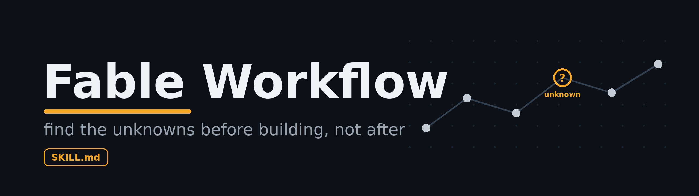
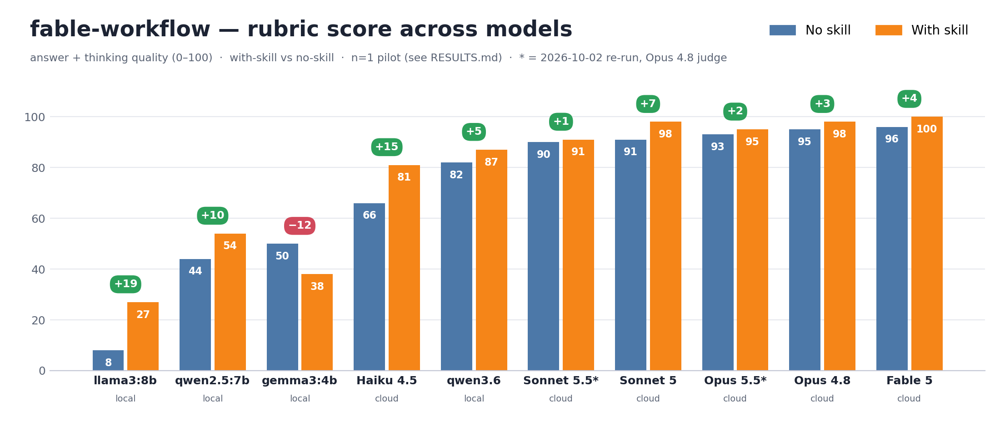

<p align="center">
  
</p>

<h1 align="center">Fable Workflow</h1>

<p align="center">
  어떤 모델(Opus, Sonnet, Haiku, Fable)에게도 Anthropic의 Fable처럼 일하게 만드는
  이식 가능한 에이전트 스킬입니다. 핵심은 <b>"만들기 전에 모르는 것(unknown)을 먼저 드러내고 만든 뒤에 검증한다"</b>입니다.
</p>

<p align="center">
  <a href="README.md">English</a> · <b>한국어</b>
</p>

<p align="center">
  
  
  
</p>

---

## 이게 뭔가요

`fable-workflow`는 Anthropic의 Fable 계열 모델과 일하는 작업 방법을 재사용 가능한 [`SKILL.md`](SKILL.md) 하나로 정리한 것입니다. Claude Code, Cursor, 또는 어떤 에이전트 프레임워크에도 그대로 넣을 수 있습니다.

요즘 모델은 스스로 방대한 해답 공간을 탐색할 만큼 강력합니다. 병목은 모델이 움직이기 전에 **내 머릿속 지도가 실제 현실과 얼마나 맞는가**입니다.

스펙이 말하지 않은 지점 하나하나가 **unknown**(모델이 정하지 않은 결정 지점)입니다. 그냥 두면 모델은 이를 말없이 임의로 결정해 버립니다.

이 스킬은 모델이 그 unknown들을 **먼저 드러내게** 한 뒤에 만들게 합니다. 만든 결과는 실제로 돌려 본 다음에야 "완료"라고 말하게 합니다.

## 핵심 한 가지

> **지도는 영토가 아니다.** 내 계획, 스펙, 프롬프트는 *지도*이고 실제 코드베이스와 제약은 *영토*입니다. 둘이 어긋나는 지점이 바로 **unknown**입니다. 모델이 추측하게 두지 말고 그 결정을 명시적으로 내리세요.

## 작업 루프

1. **족쇄 풀기(Unhobble).** 기억이 아니라 도구를 쓰게 합니다. 세기와 열거와 조회는 *스크립트로* 풀게 하세요. 모델이 확신하지 못하는 이름은 사용자가 쓴 그대로 검색하게 합니다.
2. **모르는 것 찾기.** 만들기 전에 블라인드 스팟 패스, 나를 인터뷰시키기, 취향 결정은 여러 변형(N개) 제시, 스펙 대신 레퍼런스(다른 지도) 주기를 씁니다.
3. **만들기: 검사를 먼저 정하고 이탈을 기록한다.** 첫 수정 전에 "완료"를 가르는 명령을 적어 둡니다(버그라면 실패하는 재현 검사). 마주친 unknown과 그때의 선택은 ASSUMPTIONS / NOTES 목록으로 남깁니다. 범위 밖 버그는 후속 작업으로만 적습니다.
4. **검증: 실제로 돌려 본다.** 실행하거나, 로직이 깨지면 실패하는 가장 작은 검사를 써서 결과를 직접 확인합니다.
   그 검사가 고치기 전 코드에서 먼저 실패하는지도 지켜봅니다. 서브에이전트가 보고한 "완료"는 증거가 아니라 주장입니다.
   검증이 실패하면 한정된 교정 루프가 맡습니다(시도마다 가설 하나, 반복 횟수 상한, 막히면 새 세션).
5. **루프 안에 남기.** 큰 변경 뒤 병합이나 PR 전에 모델이 변경 내용을 퀴즈로 확인하자고 제안합니다. 받을지는 사용자가 정합니다.

모델이 물어볼 수 없는 상황(원샷이나 자율 실행)에서도 unknown 목록은 씁니다. 각 항목에는 보수적인 기본값을 고릅니다. 되돌릴 수 없거나 외부로 나가는 단계(삭제, 덮어쓰기, push, 전송, 지출)는 하지 않고 "결정 필요" 항목으로 남기며 실행할 명령을 붙입니다.

모든 답변은 루프를 돌든 안 돌든 답부터 말합니다. 핵심 주장마다 Verified, Likely, Assumption 중 하나를 표시하고 확인하지 않은 것을 마지막에 적습니다.

전체 방법은 [`SKILL.md`](SKILL.md), 복사해서 바로 쓰는 프롬프트는 [`prompts.md`](prompts.md)를 참고하세요.

답변마다 지키는 규율은 [`standing-orders.md`](standing-orders.md), 교정 루프는 [`loop-engineering.md`](loop-engineering.md), 다단계 완료 게이트는 [`completion-gate.md`](completion-gate.md)에 있습니다.

## 설치

### Claude Code: 플러그인 (권장)
```shell
/plugin marketplace add joey114132/fable-workflow-skill
/plugin install fable-workflow
```

### Claude Code: 수동 복사
```bash
git clone https://github.com/joey114132/fable-workflow-skill.git
./fable-workflow-skill/install.sh ~/your-project/.claude/skills
```
`install.sh`는 `SKILL.md`와 참조 파일 네 개(`prompts.md`, `standing-orders.md`, `loop-engineering.md`, `completion-gate.md`), 그리고 `scripts/goals.py`를 `~/your-project/.claude/skills/fable-workflow/`에 복사합니다. Claude Code는 `SKILL.md`를 자동으로 찾아 `description`을 보고 발동합니다.

훅은 플러그인에서만 동작하므로 복사하지 않습니다.

다시 실행하면 설치된 파일을 덮어쓰므로 로컬 수정은 다른 곳에 두세요.

### Cursor
```bash
git clone https://github.com/joey114132/fable-workflow-skill.git
mkdir -p .cursor/rules
cp fable-workflow-skill/integrations/cursor/fable-workflow.mdc .cursor/rules/
```
Cursor가 규칙의 `description`을 보고 필요할 때(agent-requested) 자동으로 불러옵니다.

### Antigravity, Codex, Aider, Zed 등 AGENTS.md 지원 에이전트
이식용 규칙 파일을 프로젝트 루트에 복사하세요.
```bash
cp fable-workflow-skill/integrations/AGENTS.md ./AGENTS.md
```
Antigravity는 `.agents/rules/`에 두거나, 전역 규칙은 `~/.gemini/GEMINI.md`도 읽습니다. 두 어댑터 모두 전체 방법을 줄여 담고 있으며 훅은 없습니다.

모든 어댑터와 툴별 상세는 [`integrations/`](integrations/)를 보세요.

## 강제 적용 (Claude Code 플러그인)

플러그인으로 설치하면 `fable-workflow`는 훅 두 개(`hooks/`, 표준 라이브러리만 쓰는 Python)로 방법을 **강제**합니다.

- `UserPromptSubmit`은 `inject_method.py`를 **모든** 프롬프트에서 실행하고 짧은 한 줄(약 100~165자로 어림해 약 25~45토큰)만 주입합니다. 프롬프트에 가장 먼저 맞는 규칙이 그 줄을 정합니다.
  - 버그, 크래시, 실패하는 테스트는 "investigate"입니다(재현하고 가설 3개 이상을 경쟁시킨 뒤 전후로 검증).
  - "interview me"는 "먼저 인터뷰"입니다.
  - 질문은 "기억 말고 근거로 답하기"입니다.
  - 여러 단계는 "완료 게이트로 분해"입니다.
  - 오타나 한 줄 수정은 "small fix, 격식 없이"입니다.
  - 만들어 달라는 요청은 "열린 결정을 먼저 밝히고 만든 뒤 돌려 보기"입니다.
  - 그 밖의 프롬프트(`continue`, `ok`, `thanks`)는 중립적인 근거 줄을 받으며 만들기 지시는 절대 받지 않습니다.

  영어와 한국어 키워드가 모두 맞습니다. `FABLE_HOOK_LOG=<경로>`로 발동 기록을 남길 수 있습니다.
- `Stop`은 `verify_gate.py`를 실행하며 현재 턴만 봅니다. 다음 두 경우에 "아직 안 끝남"으로 표시합니다.
  - 이번 턴에 코드 파일을 고쳤는데 그 뒤에 아무것도 실행하지 않았습니다.
  - 완료 게이트 원장에 열린 goal이 남아 있습니다(읽을 수 없는 원장도 안 끝난 것으로 칩니다).

  기본은 **권고(advisory)**입니다. 경고는 사용자에게만 보이고 모델은 보지 못합니다. `FABLE_STRICT=1`로 두면 종료를 막고 그 이유를 모델에게 돌려보냅니다. 막는 것은 종료 시도당 한 번입니다.

완료 게이트(`scripts/goals.py`)는 다단계 작업을 여러 goal로 분해합니다. 각 goal은 증거(evidence)가 있어야만 완료됩니다. 마지막 goal은 검증 명령과 그 결과 없이는 "완료"를 거부하는 **검증 스토리**입니다.

스킬 안에서 Claude는 `python3 ${CLAUDE_SKILL_DIR}/scripts/goals.py <subcommand>`(`create`, `next`, `checkpoint`, `status`, `reset`)로 실행합니다.

다단계 훅 줄은 모델에게 절대 경로를 알려 줍니다. 원장은 프로젝트 루트의 `.fable/goals.json`이며 원자적으로 기록됩니다. [`completion-gate.md`](completion-gate.md)를 참고하세요.

증거는 스스로 보고한 값이고 스크립트는 비어 있지 않은지만 확인합니다. 각 goal은 대화 기록을 읽는 사람이 달성 여부를 판단할 수 있게 쓰세요.

두 검사 모두 휴리스틱이라 오작동할 수 있습니다(예: "원하시면 X 하겠습니다" 같은 선언형이 실행을 건너뛴 것처럼 보일 수 있습니다).

그래서 Stop 게이트는 기본이 권고이고 차단은 옵트인입니다. 로직은 `hooks/test_hooks.py`와 `scripts/test_goals.py`로 검증합니다.

## Evals

`evals/`에는 문구가 아니라 행동을 보는 `claude plugin eval` 케이스가 일곱 개 있습니다.

중요한 질문만 하는 아키텍처 인터뷰, 출처를 밝히거나 불확실하다고 표시해야 하는 오래된 사실, 가정을 밝히는 원샷 빌드, 격식 없이 끝내는 사소한 수정, 그리고 세 개가 더 있습니다. 저장소 루트에서 실행합니다.

```bash
claude plugin eval . --no-publish
claude plugin eval . --no-publish --allow-tools WebSearch WebFetch   # evidence 케이스가 검색할 수 있게 함
```

각 케이스는 플러그인이 있을 때와 없을 때(baseline arm)로 돌며 이 구분은 하네스가 알아서 합니다.

결과는 `evals/results/`에 쌓입니다(gitignore). Bash는 `socat` 없이는 허용할 수 없어서 "돌려서 검증하기" 행동은 이 스위트가 다루지 못합니다. 통과시키려고 케이스를 고치지 마세요.

## 벤치마크

이 스킬이 실제로 모델의 행동을 바꿀까요?

일부러 모호하게 쓴 스펙으로 A/B 테스트를 했습니다.

스펙은 *"Users shouldn't be able to spam our API. Limit it to 100 requests per minute."* 이고 아키텍처를 바꿀 만한 unknown이 약 8개 숨어 있습니다.

클라우드와 로컬을 합쳐 여덟 모델을 스킬 있음/없음으로 나눠 돌렸습니다.

"스킬 있음"은 핵심 지시만 담은 짧은 원샷 프롬프트(unknown을 기본값과 함께 나열한 뒤 구현)입니다.

자세한 문구는 [`benchmark/RESULTS.md`](benchmark/RESULTS.md)의 Reproduce에 있습니다. 이것은 전체 `SKILL.md`나 훅이 아닙니다.



| 모델 | 종류 | 스킬 없음 | 스킬 있음 | Δ |
|---|---|:---:|:---:|:---:|
| llama3:8b | local | 8 | 27 | **+19** |
| qwen2.5:7b | local | 44 | 54 | +10 |
| gemma3:4b | local | 50 | 38 | **−12** |
| **Haiku 4.5** | cloud | 66 | 81 | **+15** |
| qwen3.6 | local | 82 | 87 | +5 |
| **Sonnet 5** | cloud | 91 | 98 | +7 |
| **Opus 4.8** | cloud | 95 | 98 | +3 |
| **Fable 5** | cloud | 96 | 100 | +4 |
| **Sonnet 5.5** (2026-10-02) | cloud | 90 | 91 | +1 |
| **Opus 5.5** (2026-10-02) | cloud | 93 | 95 | +2 |

**답변과 사고 품질**을 100점 만점으로, Thinking /50 + Answer /50로 나눠 채점했습니다([상세 기준과 세부 점수](benchmark/RESULTS.md)).

대표 실행에서 이 스킬은 모델의 코드보다 추론을 더 좋아지게 했습니다. *사고* 품질은 모든 모델에서 올랐지만(+2~+18), *답변* 품질은 모델이 그 계획을 이미 구현할 수 있을 때만 올랐습니다. 약한 로컬 모델은 제자리이거나 떨어졌습니다.

로컬 재실행은 단일 시행이 얼마나 흔들리는지 보여 줍니다. gemma3는 같은 조건의 두 실행 사이에서 −12에서 +42로 움직였습니다. 가장 강한 로컬 모델인 qwen3.6은 이후 재현에서 떨어졌습니다(Thinking 40 → 32, 총점 90 → 75).

총점 향상이 가장 큰 쪽은 "능력은 있으나 덜 추론하던" 모델입니다(llama3:8b +19, Haiku 4.5 +15). Fable 5는 도움 없이도 **96점**이었습니다.

방향을 보는 파일럿으로 읽어 주세요. 클라우드 행은 모두 단일 시행입니다. 7월 행은 Opus 4.8이 직접 채점했습니다.

7월에 측정한 클라우드 모델 가운데 Haiku 4.5를 뺀 셋(Fable 5, Opus 4.8, Sonnet 5)은 이제 legacy입니다. 2026-10-02에 같은 과제를 Opus 5.5와 Sonnet 5.5로 다시 돌렸습니다. 이번에는 단순한 `claude -p` 호출로 답을 받았고, 시험 대상이 아닌 모델이 네 답을 가린 채 채점했습니다. 두 모델 모두 1~2점 움직였는데 단일 시행의 잡음 범위입니다. 지금 모델은 이 unknown 대부분을 스스로 짚기 때문입니다. Fable 5.1은 다시 돌리지 않았습니다.

[`evals/`](#evals) 스위트가 재현 가능한 대체물입니다. 짧은 프롬프트가 아니라 실제 배포되는 플러그인을 시험하기 때문입니다.

전체 방법론, 채점 기준, 모델별 근거, 한계는 **[benchmark/RESULTS.md](benchmark/RESULTS.md)** 를 보세요.

## 저장소 구조

```
fable-workflow-skill/
├── SKILL.md            # 스킬 본체 (그대로 드롭인, 방법론 원본)
├── standing-orders.md  # 답변마다 지키는 규율 + 발신 전 게이트
├── prompts.md          # 복사해서 쓰는 프롬프트 템플릿
├── loop-engineering.md # act → verify → correct → repeat (교정 루프)
├── completion-gate.md  # 멀티 스토리 완료 게이트 (사용법)
├── .claude-plugin/     # 플러그인 매니페스트 (plugin.json + marketplace.json)
├── hooks/              # 플러그인 강제 적용: 주입 + 검증 게이트 (+ 테스트)
├── scripts/            # goals.py 완료 게이트 원장 + test_goals.py
├── evals/              # claude plugin eval 케이스 (행동 검사)
├── integrations/       # 다른 툴용 어댑터
│   ├── AGENTS.md       # Antigravity · Codex · Aider · Zed · Jules …
│   └── cursor/fable-workflow.mdc
├── install.sh          # .claude/skills 디렉터리로 스킬과 goals.py 복사
├── CLAUDE.md           # 이 저장소 기여자용 메모
├── benchmark/
│   ├── RESULTS.md      # 모델 간 A/B 평가
│   └── bench.png       # 결과 차트
├── assets/banner.png
├── README.md           # English
└── README.ko.md        # 한국어
```

## 참고

이 저장소는 하나의 작업 방법을 스킬로 포장한 것입니다. Anthropic의 공식 배포물이 아닙니다.

## 라이선스

[MIT](LICENSE)
